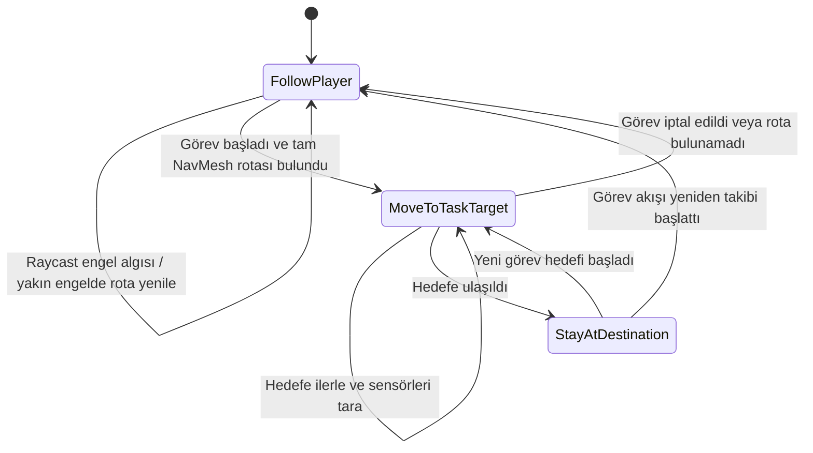

# WOKEN — Sistem Mimarisi

## 1. Genel Bakış

WOKEN, Unity ve C# ile geliştirilen 2D keşif ve kaçış oyunudur. Oyuncu laboratuvarı keşfeder, bulmacaları çözer ve yardımcı robotla birlikte görevleri tamamlar. `WokenLevelBootstrap` oyun alanı ve başlangıç bileşenlerini kurar; hareket, görev, etkileşim ve diyalog ayrı bileşenlerde yürütülür.

## 2. Bileşenler ve Sorumluluklar

| Bileşen | Sorumluluk |
|---|---|
| `WokenLevelBootstrap` | Odaları, nesneleri, karakterleri ve sistem bağlantılarını kurar. |
| `PlayerWASDController` | WASD/yön tuşu girdisini ve Rigidbody2D oyuncu hareketini yönetir. |
| `RobotMovementController` | NavMeshAgent ile takip/görev rotasını hesaplar; Rigidbody2D hareketini ve engel sensörlerini yönetir. |
| `IRobotMovementTasks` | Robot görevlerini başlatma, iptal, bekleme, devam ettirme ve sonuç bildirme sözleşmesini tanımlar. |
| `RobotRouteGuideUI` | Rota arayüzünü gösterir ve robot görevlerini `IRobotMovementTasks` üzerinden çağırır. |
| Etkileşim UI bileşenleri | İsim, şifre, batarya, laptop arşivi ve defter gibi ilgili etkileşimleri yönetir. |
| `LabRobotClient` | Gemma konuşma arayüzünü, yerel HTTP/JSON isteklerini, yanıt doğrulamasını ve çıkış kararını yönetir. |

### Nesne yönelimli tasarım

Sorumlulukları bileşenlere ayırmak tek sorumluluk yaklaşımını destekledi. Robot görev sözleşmesi `IRobotMovementTasks` ile soyutlandı. `RobotMovementController` arayüzü uyguladı; `RobotRouteGuideUI` somut hareket sınıfına doğrudan bağımlı olmadan arayüze bağlandı. Bu, bağımlılığı tersine çevirme ve arayüz tabanlı soyutlama örneğidir. İncelenen projede soyut sınıf kullanılmadı; SOLID ilkelerinin tamamının uygulandığı iddia edilmedi.

## 3. Robot NavMesh ve Sensör Karar Akışı

NavMeshAgent yürünebilir alan üzerindeki rotayı hesapladı. Robotun hareket yönünde öne bakan bir Raycast ve iki yana açılı Raycast olmak üzere üç `Physics2D.Raycast` kullanıldı. Tetikleyiciler, robotun kendi colliderları ve oyuncu engel olarak değerlendirilmedi. Yakın bir ön engel saptandığında görev/hedef rotası yeniden hesaplandı; NavMesh ana rota planlayıcısı olarak kaldı.



Takibe dönüş, görev başlatıcısının `resumeFollowing` ayarına bağlıdır. Robot testi oynanış içinde işlevsel olarak kontrol edildi; farklı başlangıç koşullarındaki deneme sayısı, başarı oranı ve ortalama süre ölçülmedi.

## 4. LLM İletişimi ve Kapı Kararı

`LabRobotClient`, `http://127.0.0.1:8765` adresine bağlandı. `/session` oturum kimliği oluşturdu; `/message` oyuncu mesajını ve sıra bilgisini iletti. İstemci sözleşmesindeki istek alanları `session_id`, `message`, `turn`; yanıt alanları `session_id`, `reply`, `decision`, `error`, `turn`, `remaining`, `score`, `door_open` oldu. İleti 1–400 karakterle sınırlı, istek timeout değeri 600 saniyeydi.

```mermaid
sequenceDiagram
    actor Player as Oyuncu
    participant UI as Gemma UI
    participant Client as LabRobotClient
    participant Service as Yerel servis
    participant Model as Ollama/Gemma
    participant Door as Elektrikli çıkış kapısı
    Player->>UI: Mesaj yazar
    UI->>Client: SendMessageToRobot
    Client->>Service: POST /session (gerekiyorsa)
    Service-->>Client: session_id
    Client->>Service: POST /message (session_id, message, turn)
    Service->>Model: Diyalog isteği
    Model-->>Service: Yanıt ve karar
    Service-->>Client: JSON
    Client->>Client: Şema ve karar tutarlılığını doğrula
    alt allow ve door_open=true
        Client-->>UI: reply göster
        Client->>Door: Konuşma kapatılınca çıkış akışını başlat
    else deny veya pending
        Client-->>UI: reply göster; kapıyı açma
    else ağ, JSON veya şema hatası
        Client-->>UI: Hata durumunu göster; oyun kararını uygulama
    end
```

Unity kapıyı yalnızca `decision == "allow"` ve `door_open == true` birlikte olduğunda açılma akışına aldı. Boş/bozuk yanıt, eksik alan, bilinmeyen karar ve çelişkili kapı durumu reddedildi.

### Prompt/model bilgisi sınırı

Servis kaynak kodu ve başlatma paketi Unity deposunda bulunmadı. Bu yüzden tam system prompt ve Ollama modelinin tam etiketi servis yapılandırmasından henüz doğrulanamadı. Test bilgisayarının görüntülerinde 8 GB DDR4 RAM, NVIDIA GeForce GTX 1650 Ti üzerinde 4 GB ayrılmış GPU belleği ve Intel UHD tümleşik GPU görüldü; CPU modeli görünmedi. Bu kaynak sınırları düşük bellek kullanan/kuantize model seçimini destekler; kullanılan gerçek model etiketi ve seçim gerekçesi servis bilgisiyle netleştirilecektir. Ekran kayıtları testte gözlenen davranışı gösterir; prompt metnini kanıtlamaz.

## 5. Hata Yönetimi ve Test Sınırı

`LabRobotClient`, UnityWebRequest hatalarını ve timeout durumunu status metni olarak gösterir. Sunucunun `error` alanı, boş/geçersiz JSON, geçersiz oturum kimliği, reply veya decision eksikliği ve decision ile `door_open` çelişkisi başarısız yanıt sayılır. Bu durumda LLM kararı kapı akışına uygulanmaz. Timeout 600 saniyedir.

Bu hata yolları kod incelemesinde doğrulandı; bu rapor çalışmasında servis kapatma, model eksikliği veya bozuk JSON hata enjeksiyon testi yapılmadı. Servis Unity deposunda olmadığı için başka bilgisayarda temiz kurulum da doğrulanmadı. LLM senaryo testleri geliştirme bilgisayarında yürütüldü.

## 6. Mimari İlkeler

- Hareket, görev, arayüz ve LLM istemcisi ayrı bileşen sorumlulukları olarak tutuldu.
- Robot görev tüketicisi arayüz üzerinden soyutlandı.
- LLM metni doğrudan oyun dünyasını değiştirmedi; kapı kararı istemci doğrulamasından geçti.
- Servis uygulaması Unity istemcisinden ayrı çalıştı; kaynak paketinin teslim edilmesi dağıtım için gerekli kaldı.
